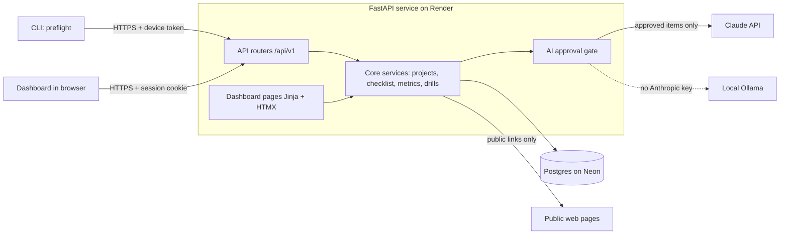
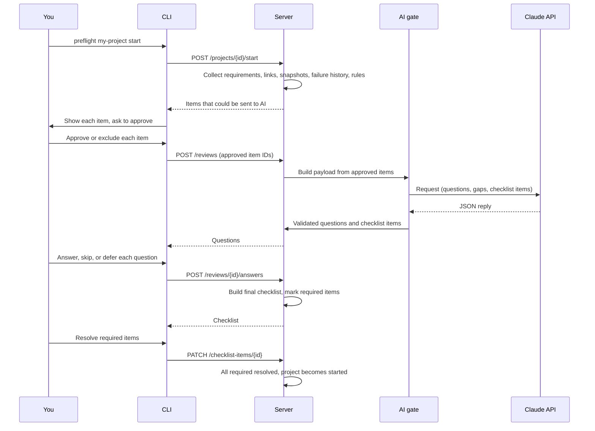

# Preflight: Design and Technology

Version 0.2 | 2026-10-18

Companion to [the requirements](requirements.md). That document says what Preflight does. This one says how it is built, what it runs on, and what it costs. The [CLI](cli.md), [configuration](configuration.md), [API](api.md), and [data model](data-model.md) references are generated from the code by `scripts/gen_docs.py`.

---

## 1. Summary of decisions

| Area            | Decision                                                                               |
| --------------- | -------------------------------------------------------------------------------------- |
| Shape           | One hosted FastAPI service that serves both the JSON API and the dashboard             |
| API style       | API-first. The CLI and the dashboard use the same `/api/v1` endpoints                  |
| UI              | Server-rendered pages (Jinja + HTMX + Chart.js). No separate frontend app in version 1 |
| CLI             | Python (Click), a thin client. It holds no data of its own except an offline queue     |
| Database        | Postgres (Neon Free to start). SQLite for local development and tests                  |
| Dashboard login | Username and password, hashed, session cookie, optional TOTP                           |
| CLI login       | `preflight login` using browser sign-in (device flow). Per-device token                |
| AI              | Claude API, or a local Ollama model when no key is set. Server only, always gated      |
| Link capture    | Public links only: httpx + trafilatura, Playwright as a fallback                       |
| Scheduling      | Computed on demand when a command runs. No background daemon                           |
| Hosting         | Render Starter web service + Neon Free Postgres                                        |
| Budget          | Under $16/month all-in (target about $10-13)                                           |

## 2. Goals and constraints

- Single user, with a dashboard reachable from a website and a CLI that works from any machine
- Under $16/month in total, including the Claude API
- Nothing sent to AI without per-item approval
- Logging a failure takes under one minute
- Numbers on the dashboard come from plain code, not AI
- Simple enough to build and run alone

## 3. Architecture



Rules:

- Route handlers are thin. Logic lives in the core service modules so the CLI, UI, and tests all share it.
- The database is never exposed to the CLI. Only the API talks to it.
- All AI calls go through one gate module. Only `ai/client.py` imports the Claude SDK, and a test enforces it.

## 4. Components

| Component           | Responsibility                                                                                                                      |
| ------------------- | ----------------------------------------------------------------------------------------------------------------------------------- |
| **CLI**             | Parses `preflight <project> <action>`, calls the API, prints results, walks through checklist prompts, queues failures when offline |
| **API routers**     | Auth, projects, requirements, links, reviews, checklist items, failures, wins, predictions, drills, reports, export                 |
| **Dashboard**       | Login page, project progress, failures, rules, drills, calibration, weekly report                                                   |
| **Core services**   | Pattern detection, checklist builder, gate logic, metric calculation, spaced repetition, rule verdicts                              |
| **AI gate**         | Builds the payload, lists every item, requires approval, logs what was sent, calls Claude, validates the JSON reply                 |
| **Link capture**    | Fetches public pages, extracts readable text, stores versioned snapshots                                                            |
| **Scheduler logic** | Finds due drills, rules awaiting a verdict, and the weekly report when a command or page loads                                      |
| **Auth**            | Password hashing, sessions, device tokens, TOTP, rate limiting, audit log                                                           |

## 5. Main flows

### 5.1 Start a project



### 5.2 Log a failure

1. `preflight <project> fail "..."` sends the text to the API.
2. The server saves it and returns related checklist items and similar past failures.
3. You link the failure to a checklist item or mark it "not on the checklist".
4. If AI suggestions are enabled and approved, category and root cause suggestions are returned for you to confirm.
5. If the server is unreachable, the CLI stores the failure in a local queue and retries later.

### 5.3 Rule lifecycle

1. A pattern repeats (same category, same project or topic).
2. The server suggests a rule drafted from your prevention notes.
3. You edit and approve it. It becomes active and appears in matching project checklists.
4. After the observation period (default 4 weeks) a verdict is computed from failure counts before and after: working, needs revision, or retired.

### 5.4 Close a project

1. `preflight <project> close` asks for wins, unlogged failures, and which checklist items helped, were missed, or were irrelevant.
2. The data feeds patterns, rules, drills, and the dashboard.

## 6. Authentication

### 6.1 Dashboard

- One account, created at deploy time from environment variables or with a setup command.
- Password stored only as an Argon2 hash.
- Login form issues a session cookie: `HttpOnly`, `Secure`, `SameSite=Lax`.
- Sessions expire after inactivity. Logout is available.
- Rate limiting and temporary lockout after repeated failures.
- CSRF protection on all forms.
- HTTPS only. Plain HTTP redirects or is refused.
- Optional TOTP second factor (recommended for a site on the internet).

### 6.2 CLI

- `preflight login` uses the device flow:
  1. The CLI asks the server for a device code and prints a short code.
  2. The CLI opens the dashboard login page. You sign in there (password and TOTP).
  3. You confirm the code. The CLI receives a token for this device.
- Your password never passes through the terminal and is never stored by the CLI.
- Short-lived access token plus a refresh token, stored in the OS keyring (or a file readable only by you).
- `preflight logout` clears the token. `preflight auth devices` lists devices and can revoke one.
- Fallback: a terminal password prompt with hidden input, HTTPS-only, used once to obtain a token. Never a command-line flag or environment variable.

### 6.3 Why not the password in the terminal by default

- Leaks through shell history, process lists, environment variables, terminal recordings, and logs.
- The CLI and every dependency would handle the raw password.
- No clean support for TOTP or passkeys.
- A fake CLI or a mistyped `http://` URL can capture it.
- A password gives full, non-revocable access. A device token can be scoped and revoked.

### 6.4 Separation

- Dashboard sessions and CLI tokens are separate credentials. Revoking one device does not log out the website.
- CLI tokens cannot open the dashboard. The password cannot be used as an API token.

## 7. AI integration

- The Claude API is called only by the server, using a key stored in an environment variable.
- **Approval gate** (single module):
  - Builds a list of items (requirements version, approved snapshots, link notes, selected failures).
  - Shows the list with approximate token count and cost estimate.
  - Sends only approved items. Items marked sensitive are never offered.
  - Stores the exact payload and response for audit, along with the prompt version.
  - Approval is per review and not remembered.
- Output is requested as JSON and validated with Pydantic. Invalid output is retried once, then reported as a failure.
- Every AI-created checklist item must include a source reference (failure ID, rule, or requirement line). Items without one are dropped.
- Nothing AI-generated is saved as a rule or checklist item until you approve or edit it.
- Model use:
  - Stronger model for the project review.
  - Smaller, cheaper model for failure classification and drill grading.
- Cost controls: monthly spend limit in the Anthropic Console, output token caps, relevant-failures-only context, and prompt caching for the repeated history prefix. Each call reserves its worst-case cost before it is sent, and a call that would pass `PREFLIGHT_AI_MONTHLY_BUDGET_USD` is refused. The weekly report uses no AI.
- Providers sit behind one interface in `ai/client.py`. Each provider owns its models, prices, context size, and availability.
  - With `PREFLIGHT_ANTHROPIC_API_KEY`, reviews use Claude Opus 5.5 and the smaller tasks use Claude Haiku 5.5, with server-side refusal fallbacks on Opus.
  - Without a key, `ai/ollama.py` calls a local Ollama server with the same JSON schema. It asks Ollama to refuse input longer than the context instead of truncating it.
- Material longer than the model's context is split on line boundaries into several calls. The history and notes ride in every call. A draft may cite only what its own call received: failure and rule tags when history was sent, numbered requirement lines in that part, and the link and snapshot items themselves.
- If a later call in a review fails, a retry reuses the earlier calls' logged replies instead of paying for them again. A deliberate re-review always asks fresh.
- Without any provider the app still logs failures, builds rule-based checklists, and shows the dashboard.

## 8. Public link capture

- Internal links are saved as references only and are never fetched.
- Public capture order:
  1. `httpx` fetch with robots check and rate limiting.
  2. `trafilatura` for main-text extraction.
  3. Playwright fallback only when the page needs JavaScript.
- Pages that require a login are detected and skipped with a clear message.
- Snapshots store URL, title, headings, text, tables, and capture time, and are versioned. Refresh creates a new version.
- You preview every snapshot before it can be used.
- Every request connects to an address that was checked as public, on every redirect. A second DNS answer cannot point capture at the server's own network. Responses stop at 5 MB and 30 seconds.
- Playwright is an optional install, since it is large, and the browser is off unless `PREFLIGHT_CAPTURE_BROWSER` is set. When on, every browser request passes the same address check. Hosted capture can run on a small separate job if the web service is too small for a browser.

## 9. Data

[The data model reference](data-model.md) lists every table and column. Design notes:

- Postgres on the host, SQLite for local development and tests, through SQLAlchemy.
- Migrations with Alembic from day one.
- Primary keys are UUIDs.
- Add `user_id` to every table from the start, even with one user, so a second user never needs a data migration.
- Snapshots and AI payloads are stored as text. Large snapshots are capped (for example 200 KB) and truncated with a flag.
- Full-text search on failures with Postgres `tsvector`.
- Embeddings and `pgvector` are deferred until there are a few hundred failures.
- Soft delete is not needed. Deleting a project deletes its snapshots and drills.

## 10. API outline

Base path `/api/v1`. All endpoints require a session cookie or a bearer token. [The API reference](api.md) lists every endpoint. The outline below groups the main ones.

| Area               | Endpoints                                                                                                                                      |
| ------------------ | ---------------------------------------------------------------------------------------------------------------------------------------------- |
| Auth               | `POST /auth/login`, `POST /auth/logout`, `POST /auth/device/code`, `POST /auth/device/token`, `GET /auth/devices`, `DELETE /auth/devices/{id}` |
| Projects           | `POST /projects`, `GET /projects`, `GET /projects/{id}`, `POST /projects/{id}/start`, `POST /projects/{id}/close`                              |
| Requirements       | `GET /projects/{id}/requirements`, `PUT /projects/{id}/requirements`                                                                           |
| Links              | `POST /projects/{id}/links`, `GET /projects/{id}/links`, `POST /links/{id}/capture`, `POST /links/{id}/refresh`                                |
| Review             | `POST /projects/{id}/reviews`, `GET /reviews/{id}`, `POST /reviews/{id}/answers`                                                               |
| Checklist          | `GET /projects/{id}/checklist`, `PATCH /checklist-items/{id}`                                                                                  |
| Failures           | `POST /projects/{id}/failures`, `GET /failures`, `GET /failures/{id}/similar`                                                                  |
| Wins               | `POST /projects/{id}/wins`                                                                                                                     |
| Patterns and rules | `GET /patterns`, `GET /rules`, `POST /rules`, `PATCH /rules/{id}`                                                                              |
| Drills             | `GET /drills/today`, `POST /drills/{id}/review`                                                                                                |
| Predictions        | `POST /projects/{id}/predictions`, `GET /projects/{id}/predictions`, `POST /predictions/{id}/close`                                            |
| Reports            | `GET /progress`, `GET /reports/weekly`, `GET /projects/{id}/status`                                                                            |
| Export             | `GET /export?format=csv\|json\|md`                                                                                                             |

## 11. Technology choices with trade-offs

| Area               | Choice                                                   | Pros                                                                    | Cons                                                                      | Alternative                                         |
| ------------------ | -------------------------------------------------------- | ----------------------------------------------------------------------- | ------------------------------------------------------------------------- | --------------------------------------------------- |
| Language           | Python 3.12+                                             | Your core stack, best AI SDK support, SQLite and CLI libraries          | Slower CLI startup than a compiled binary                                 | TypeScript, Go                                      |
| CLI                | Click (custom project-first group), Rich                 | Full control of `preflight <project> <action>`, good prompts and tables | Small amount of custom routing, project names cannot equal reserved words | Typer, argparse                                     |
| API                | FastAPI + Pydantic                                       | Your stack, typed, shares models with the AI output validation          | None significant                                                          | Flask                                               |
| UI                 | Jinja + HTMX + Chart.js                                  | No build step, Python only, enough for forms, tables, charts            | Less polished than a SPA                                                  | React or Vite SPA                                   |
| Database           | Postgres (Neon)                                          | Hosted, familiar, FTS and pgvector available later                      | Free tier has limits and a short cold start                               | SQLite, Render Postgres                             |
| ORM and migrations | SQLAlchemy + Alembic                                     | Typed, familiar, same models for SQLite and Postgres                    | More ceremony than raw SQL                                                | SQLModel, plain SQL                                 |
| AI                 | Anthropic SDK direct                                     | Easy to audit exactly what is sent                                      | Prompts and retries are your code                                         | LangChain (heavier, harder to audit)                |
| Link capture       | httpx + trafilatura + Playwright fallback                | Fast and private, browser only when needed                              | Playwright is a large optional dependency                                 | Hosted reader services (send URLs to a third party) |
| Spaced repetition  | SM-2                                                     | About 20 lines of code                                                  | Less accurate than newer methods                                          | FSRS                                                |
| Scheduling         | On demand                                                | No daemon, always current                                               | No reminders unless a command runs                                        | cron or APScheduler                                 |
| Auth               | Own implementation (Argon2, sessions, device flow, TOTP) | Matches your requirement, no vendor                                     | You own the security details                                              | Cloudflare Access, Tailscale, OAuth sign-in         |
| Packaging          | `uv tool install` or `pipx`                              | One command, isolated environment                                       | Needs Python installed                                                    | Docker, PyInstaller                                 |
| Hosting            | Render Starter + Neon Free                               | Always-on app, cheapest managed path                                    | Free database has no uptime guarantee                                     | Hetzner VPS, Fly.io                                 |

## 12. Hosting and cost

Prices were found through web searches in October 2026 and move often. Confirm on each provider's page before paying.

### 12.1 Recommended: Render Starter + Neon Free

| Item                                                                              | Monthly cost |
| --------------------------------------------------------------------------------- | ------------ |
| Render Starter web service (512 MB, 0.5 CPU, always on)                           | $7           |
| Neon Free Postgres (100 CU-hours, 0.5 GB storage, scales to zero after 5 minutes) | $0           |
| Domain (about $10-15 per year)                                                    | ~$1          |
| Claude API (reviews, classification, grading)                                     | ~$2-5        |
| **Total**                                                                         | **~$10-13**  |

### 12.2 Alternatives

| Option                           | Hosting | Total with AI and domain | Notes                                                                     |
| -------------------------------- | ------- | ------------------------ | ------------------------------------------------------------------------- |
| Hetzner VPS with Docker          | ~$5-10  | ~$8-16                   | Most headroom, you manage updates, backups, HTTPS                         |
| Render Free + Neon Free          | $0      | ~$3-6                    | Web service sleeps after 15 idle minutes and takes about a minute to wake |
| Fly.io, self-run Postgres        | ~$8-13  | ~$11-19                  | You manage database crashes and backups                                   |
| Render Starter + Render Postgres | ~$13    | ~$16-19                  | One provider, managed backups, borderline on budget                       |
| Railway Hobby                    | ~$10-20 | ~$13-26                  | Usage-based, bill varies                                                  |

Avoid: Fly.io managed Postgres (from $38/month), Render Standard instances ($25/month), separate paid Redis.

### 12.3 AI cost estimate

- Claude Opus 5.5, used for reviews, costs $4 per million input tokens and $20 per million output tokens. Claude Haiku 5.5, used for the smaller tasks, costs $0.10 and $0.50. Check the current pricing page before relying on these.
- Project review: about 25k input and 3k output tokens, roughly $0.16 (more with long snapshots).
- Failure classification and drill grading: well under $0.01 each.
- A busy month (4 project reviews, 60 failures, 150 drills): about $1-3.
- A local Ollama model costs nothing per call.

### 12.4 Splitting the UI from the API

- A static UI on Cloudflare Pages is free (unlimited static requests and bandwidth, 500 builds per month on the free plan), so splitting adds about $0 in cost.
- It adds effort: a single-page app, CORS, cross-site cookie handling, and two deployments.
- Decision: keep one service for version 1. The API-first design makes a later split cheap.

## 13. Security

- HTTPS everywhere.
- Passwords and tokens stored only as hashes. Secrets in environment variables, never in the database or git.
- Rate limiting and lockout on login and token endpoints.
- CSRF protection for the dashboard, security headers, dependency updates.
- Audit log: logins, token creation and revocation, AI payloads sent, gate overrides.
- Database not publicly exposed. Only the web service connects to it.
- Backups: Neon point-in-time restore on paid plans, or a nightly dump to object storage. Test a restore once.
- Delete options for projects, snapshots, and tokens. Export always available.
- Internal links are never fetched and never sent to AI beyond title, URL, and your note (with approval).
- Optional hardening: put the site behind Cloudflare Access or Tailscale so the login page is not public.

## 14. Reliability and offline behavior

- If the server is unreachable, `fail` and `win` entries go to a local queue file and are sent on the next successful command.
- Reviews, checklists, and reports need the server and report a clear error when it is down.
- Free-tier cold starts are handled with a short timeout, a retry, and a "waking the server" message.
- Neon scale-to-zero adds a short delay after idle. Acceptable for a single-user tool.

## 15. Testing

- `pytest` with a fake AI client so tests are fast and free. `tests/fakes.py` also has local fakes of the Anthropic Messages API and of Ollama, so the real clients are tested over HTTP.
- A golden test (`tests/golden/review_payload.txt`) pins the exact review payload, so a prompt change shows up as a diff.
- An evaluation set (`evals/review_cases.json`, run by `scripts/eval_review.py`) scores review quality against the configured provider. Results are in `evals/results/`.
- Unit tests for every dashboard metric, since the dashboard's credibility depends on them.
- Auth tests: login, lockout, device flow, token revoke, CSRF.
- Gate tests: nothing is sent without approval, and sensitive items are never offered.
- `scripts/e2e.py` drives the real migration, server, CLI binary, and dashboard forms.
- `scripts/validate_requirements.py` checks every requirement against passing tests and end-to-end checks, and `scripts/mutation_check.py` breaks key protections on purpose to prove the tests catch them. `scripts/check.sh` runs all of it.

## 16. Repository layout

```text
project-revise/
  pyproject.toml
  src/preflight/
    cli/              # Click commands, API client, offline queue, importer
    server/
      main.py         # FastAPI app factory; asgi.py builds the app for uvicorn
      api/v1/         # routers
      ui/             # pages, templates, static files
      auth/           # hashing, sessions, device flow, TOTP, lockout, rate limit
    core/             # projects, checklist, lifecycle, review, patterns, metrics, drills, export
    ai/               # gate, providers (Anthropic, Ollama), versioned prompts, schemas
    capture/          # fetch, extract, browser fallback
    db/               # models, migrations
  tests/              # pytest suite, fakes, golden payload
  scripts/            # check.sh, e2e, validation, mutation check, eval, doc generator
  evals/              # review evaluation cases and results
  validation/         # requirements matrix and generated report
  docs/               # requirements, design, and generated references
  .audit/             # decision log of the build
```

## 17. Build phases

| Phase             | Scope                                                                                                     | Result                                       | Status |
| ----------------- | --------------------------------------------------------------------------------------------------------- | -------------------------------------------- | ------ |
| **1. Foundation** | Repo, models, migrations, API skeleton, dashboard login, CLI login (device flow), deploy to Render + Neon | You can sign in from the website and the CLI | Built. Deploy not done. |
| **2. Capture**    | Projects, requirements, failure and win logging, search, offline queue                                    | Failures stored per project                  | Built |
| **3. Checklist**  | Pattern detection, rules, rule-based checklist, start gate, failure-to-item linking                       | Checklist before each project                | Built |
| **4. AI review**  | Approval gate, questions, gap list, requirement-aware checklist, cost estimate                            | Questions based on history                   | Built, with Ollama fallback |
| **5. Links**      | Saved links, public capture, snapshots                                                                    | Public references available to review        | Built |
| **6. Progress**   | Retrospective, dashboard metrics, rule verdicts, weekly report                                            | Evidence of improvement                      | Built |
| **7. Thinking**   | Drills, spaced repetition, predictions, calibration                                                       | Logical-thinking practice                    | Built |

[The validation report](../validation/report.md) lists the evidence for each requirement.

## 18. Risks

| Risk                                       | Handling                                                                                  |
| ------------------------------------------ | ----------------------------------------------------------------------------------------- |
| Logging feels like a chore and I stop      | One-line `fail` command, remaining fields as prompts, optional AI pre-fill, offline queue |
| Dashboard is empty at first                | `preflight import` backfills old failures with their past dates                           |
| AI invents checklist items                 | Required source reference, drop items without one, you approve before saving              |
| Private requirements sent to AI by mistake | Per-item approval, sensitive flag, payload audit log                                      |
| Free tiers change or disappear             | Standard Postgres and a plain container, so moving hosts is a config change               |
| Metrics look precise with little data      | Show counts beside percentages and hide trends until enough data exists                   |
| AI cost grows                              | Spend limit, cost estimate on the approval screen, summaries, caching, batch jobs         |
| Project named like a command               | Reserved-word check when creating a project                                               |
| Site is public and attracts attacks        | Strong password, TOTP, rate limits, optional access proxy                                 |

## 19. Open decisions

1. Confirm hosting: Render Starter + Neon Free (recommended), or a Hetzner VPS. Open.
2. Add TOTP at launch, or later. Decided: available at launch, enabled with `preflight-server enable-totp`.
3. Protect the whole site behind an access proxy (Cloudflare Access or Tailscale), or rely on the login alone. Open.
4. Use a stronger model only for project reviews and a cheaper one elsewhere, or one model for everything. Decided: Opus 5.5 for reviews and Haiku 5.5 elsewhere, with local Ollama when there is no key.
5. Backups: rely on provider restore, or add a nightly dump. Open.
6. Gate strictness and other product decisions are recorded in [the requirements' decisions](requirements.md#decisions).
